<!--
  Generated by scripts/update_readme.py from templates/profile.md.
  Edit the template or the scripts instead of this file: a GitHub Action
  rewrites it every day. See docs/how-it-works.md.
-->

  

  <b>🍂 Autumn edition</b> &nbsp;·&nbsp; 🟧🟧🟧🟧🟧🟧🟧🟧🟧⬜ 91% &nbsp;·&nbsp; 8 days until ❄️ Winter

## 🍂 About me

Hi, I’m **K4rim**! I love **cryptocurrencies**, **stocks**, **cryptography** and **AI**: pretty much anything where math, money and machines meet. I like to understand things from the ground up, so I enjoy building them from scratch.

> 🍂 Autumn mode: harvesting ideas and rebalancing.

## 🧭 What I’m into

<table>
  <tr>
    <td align="center" width="50%">
       
      <b>Cryptocurrencies</b> 
      Blockchains, tokenomics and the technology behind them
    </td>
    <td align="center" width="50%">
       
      <b>Stocks</b> 
      Markets, charts and company fundamentals
    </td>
  </tr>
  <tr>
    <td align="center" width="50%">
       
      <b>Cryptography</b> 
      Hash functions, ciphers and building primitives from scratch
    </td>
    <td align="center" width="50%">
       
      <b>AI</b> 
      Machine learning, language models and what comes next
    </td>
  </tr>
</table>

## 🔨 Featured project

**[KMD-2048](https://github.com/TheK4rim/kmd2048)**: an experimental 2048-bit hash construction. Keccak-f[1600], SHAKE256 and SHA-512 implemented from scratch in pure Python, checked against NIST and Keccak-team test vectors, with benchmarks and a security analysis.

  

## 💡 Fact of the day

🪙 Ethereum switched from proof-of-work to proof-of-stake in September 2022, an upgrade known as “The Merge”.

  <b>This profile changes with the seasons.</b> 
  <a href="seasons/winter.md">❄️ Winter</a> &nbsp;·&nbsp; <a href="seasons/spring.md">🌸 Spring</a> &nbsp;·&nbsp; <a href="seasons/summer.md">☀️ Summer</a> &nbsp;·&nbsp; <b>🍂 Autumn</b> 
  Updated every day by a GitHub Action. The season switches on 1 March, 1 June, 1 September and 1 December (UTC).

